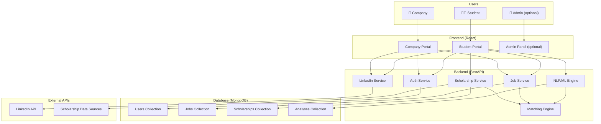
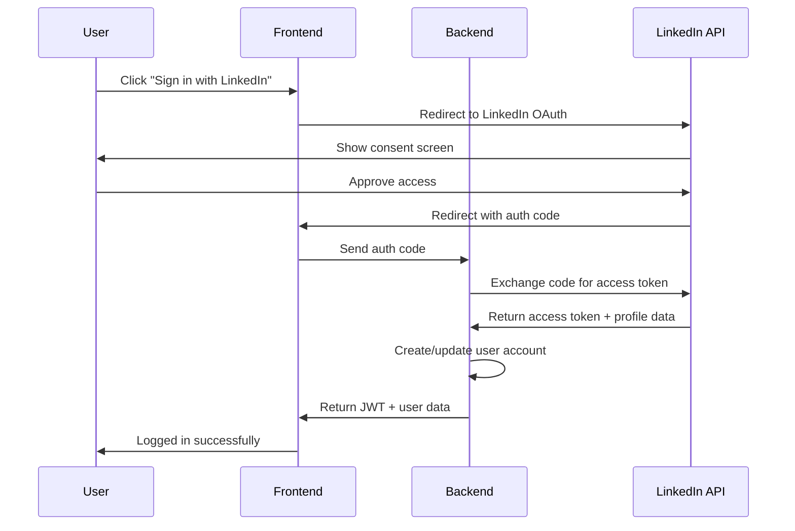

# AI Resume Analyzer — Updated Master Project Plan (v2.0)

> **Date:** October 1, 2026  
> **Status:** Plan review — incorporating new feature additions  
> **Current state:** Frontend (Phase 1) is complete. Backend NLP engine exists. New features to be integrated.

---

## What Has Changed From v1.0

The original plan was a **single-user resume analyzer**. This updated plan expands it into a **multi-role career platform** with three distinct user types and several new modules.

### New Features Requested
| # | Feature | Summary |
|---|---------|---------|
| 1 | **Company Job Posting** | Companies get a separate profile to post jobs with full descriptions |
| 2 | **Scholarship Discovery** | Students discover international scholarships for higher studies based on their CV/profile |
| 3 | **Remote Job Search** | Students find remote jobs available outside Bangladesh, matched to their CV |
| 4 | **LinkedIn Integration** | Deep LinkedIn integration across the platform where logically needed |

### Additional Features Proposed (New Ideas)
| # | Feature | Summary |
|---|---------|---------|
| 5 | **AI Cover Letter Generator** | Auto-generate tailored cover letters based on resume + job description |
| 6 | **Skill Gap Learning Path** | For each missing skill, suggest free courses (Coursera, YouTube, etc.) with links |
| 7 | **Interview Prep Module** | Generate likely interview questions based on the job description + candidate profile |
| 8 | **Resume Builder / Enhancer** | Let users restructure/rewrite sections of their resume using AI suggestions |
| 9 | **Job Alerts & Notifications** | Email/in-app notifications when new matching jobs or scholarships appear |
| 10 | **Company Reviews & Ratings** | Students can review companies (like Glassdoor-lite) |
| 11 | **Analytics Dashboard for Companies** | Companies see how many applicants viewed/applied, skill-match stats, etc. |
| 12 | **PDF Resume Export** | Download an AI-enhanced version of the resume as a polished PDF |

> [!NOTE]
> Features 5–12 are **suggestions**. You decide which ones to include. The core plan below assumes features 1–4 are confirmed. Features 5–12 are marked as optional enhancements.

---

## Updated System Architecture

### Multi-Role Architecture



### Updated User Flow

```text
┌─────────────────────────────────────────────────────────────┐
│                    AI RESUME ANALYZER v2.0                   │
├─────────────────────────────────────────────────────────────┤
│                                                             │
│  STUDENT FLOW:                                              │
│  Register/Login → Upload CV → AI Analysis → Dashboard       │
│       ├── Search Jobs (local + remote)                      │
│       ├── Toggle: Scholarship Search (abroad/higher study)  │
│       ├── Toggle: Remote Jobs (outside Bangladesh)          │
│       ├── AI Cover Letter Generator (optional)              │
│       ├── Interview Prep (optional)                         │
│       ├── Skill Learning Paths (optional)                   │
│       └── LinkedIn: Import profile / Share results          │
│                                                             │
│  COMPANY FLOW:                                              │
│  Register/Login → Create Company Profile → Post Jobs        │
│       ├── Manage Posted Jobs                                │
│       ├── View Applicants                                   │
│       ├── Company Analytics Dashboard (optional)            │
│       └── LinkedIn: Link company page                       │
│                                                             │
└─────────────────────────────────────────────────────────────┘
```

---

## Updated Technology Stack

| Layer | Technology | Purpose |
|-------|-----------|---------|
| **Frontend** | React.js + Tailwind CSS | UI for both Student & Company portals |
| **Backend** | Python + FastAPI | REST API, business logic, auth |
| **ML/NLP** | scikit-learn, NLTK, spaCy, PyMuPDF, sentence-transformers | Resume analysis, matching engine |
| **Database** | MongoDB | Users, jobs, scholarships, analyses, companies |
| **Auth** | JWT (JSON Web Tokens) | Role-based authentication (Student / Company) |
| **LinkedIn** | LinkedIn OAuth 2.0 + API | Login, profile import, sharing |
| **Job Data** | Web scraping / APIs (optional) | Remote job aggregation |
| **Scholarship Data** | Curated database + optional APIs | Scholarship listings |

---

## Feature Details

---

### FEATURE 1: Company Job Posting Portal

> **Feasibility: ✅ Fully Possible**

#### Company Registration & Profile

Companies register with a **separate role** (`role: "company"`). Their profile includes:

| Field | Description |
|-------|-------------|
| Company Name | Official company name |
| Logo | Company logo upload |
| Industry | e.g., IT, Finance, Healthcare |
| Company Size | Startup / SME / Enterprise |
| Location | HQ + other office locations |
| Website | Company website URL |
| LinkedIn Page | Link to company LinkedIn |
| Description | About the company (mission, culture, etc.) |
| Founded Year | When the company was established |
| Contact Email | HR/recruitment contact |

#### Job Posting

Each job post contains:

| Field | Description |
|-------|-------------|
| Job Title | e.g., "Full Stack Developer" |
| Department | e.g., Engineering, Marketing |
| Job Type | Full-time / Part-time / Contract / Internship |
| Location Type | On-site / Remote / Hybrid |
| Location | City, Country (or "Remote - Global") |
| Salary Range | Optional, min-max range |
| Experience Level | Entry / Mid / Senior / Lead |
| Job Description | Full detailed description |
| Required Skills | List of required skills |
| Preferred Skills | Nice-to-have skills |
| Education Requirement | Minimum degree required |
| Application Deadline | Last date to apply |
| Posted Date | Auto-generated |
| Status | Active / Closed / Draft |
| Apply Method | In-platform / External link / Email |

#### Company Dashboard

- Total jobs posted
- Active vs. closed listings
- Number of views per job
- Number of applications per job (optional)
- Edit / Close / Repost jobs

#### How It Integrates With Resume Analyzer

When a student runs a resume analysis, the system can:
1. Match their resume against **real company-posted jobs** (not just pasted job descriptions)
2. Show a "Matching Jobs" section on the analysis dashboard
3. Students can click a job → see how their resume matches → apply

#### API Endpoints (New)

```text
POST   /api/company/register
POST   /api/company/login
GET    /api/company/profile
PUT    /api/company/profile
POST   /api/company/jobs                    → Create job
GET    /api/company/jobs                    → List company's jobs
PUT    /api/company/jobs/{job_id}           → Update job
DELETE /api/company/jobs/{job_id}           → Delete job
GET    /api/jobs                            → Public: list all active jobs
GET    /api/jobs/{job_id}                   → Public: single job details
GET    /api/jobs/search?q=...&type=...      → Search/filter jobs
POST   /api/jobs/{job_id}/apply             → Student applies (optional)
```

#### Frontend Pages (New)

| Page | Description |
|------|-------------|
| Company Registration | Sign up as a company |
| Company Login | Login for companies |
| Company Dashboard | Overview of posted jobs, stats |
| Create/Edit Job | Form to post or edit a job |
| Company Profile (Public) | Public-facing company page |
| Job Listing Page (Student) | Browse all available jobs |
| Job Detail Page (Student) | See full job details + match score |

---

### FEATURE 2: Scholarship Discovery

> **Feasibility: ✅ Fully Possible**

#### How It Works

1. Student uploads their CV / fills in their profile
2. Student toggles **"Scholarship Search"** ON in their dashboard/settings
3. The system analyzes their profile and matches against a **scholarship database**
4. Shows relevant scholarships for **higher studies abroad** (Masters, PhD, Post-doc)

#### Scholarship Data Model

Each scholarship entry contains:

| Field | Description |
|-------|-------------|
| Scholarship Name | e.g., "Chevening Scholarship" |
| Country | e.g., UK, USA, Germany, Australia |
| University | Specific university (if applicable) |
| Degree Level | Masters / PhD / Post-doc / Diploma |
| Field of Study | e.g., Computer Science, Engineering, Business |
| Eligibility Criteria | GPA, nationality, age, work experience, etc. |
| Funding Coverage | Full / Partial / Tuition-only / Stipend |
| Benefits | What's covered (tuition, living, travel, etc.) |
| Application Deadline | Deadline dates |
| Application URL | Link to apply |
| Description | Full details |
| Required Documents | What to submit |
| Language Requirements | IELTS, TOEFL, GRE scores needed |
| Tags/Keywords | For matching purposes |

#### Matching Logic

The system matches scholarships based on:
- **Degree level** sought (extracted from profile or CV)
- **Field of study** (extracted from CV skills/education)
- **GPA** (if provided in profile)
- **Nationality** (Bangladeshi students → international scholarships)
- **Skills/Research area** (NLP matching between CV and scholarship requirements)
- **Language scores** (if provided)

#### Scholarship Toggle UX

```text
┌───────────────────────────────────────────┐
│  🎓 Scholarship Search                    │
│                                           │
│  [Toggle: OFF ──── ON]                    │
│                                           │
│  Looking for scholarships for higher      │
│  studies abroad? Turn this on to see      │
│  matching opportunities based on your     │
│  profile.                                 │
│                                           │
│  Preferred Degree: [Masters ▼]            │
│  Preferred Countries: [🇬🇧 🇺🇸 🇩🇪 🇦🇺 ▼]   │
│  Field of Study: [Auto-detected ✓]       │
│  IELTS/TOEFL Score: [_______] (optional)  │
└───────────────────────────────────────────┘
```

#### API Endpoints (New)

```text
GET    /api/scholarships                         → List all scholarships
GET    /api/scholarships/search?country=...       → Filter scholarships
GET    /api/scholarships/match                    → AI-matched scholarships based on profile
POST   /api/scholarships                          → Admin: add scholarship
PUT    /api/scholarships/{id}                     → Admin: update scholarship
DELETE /api/scholarships/{id}                     → Admin: delete scholarship
```

#### Data Source Strategy

For the **initial version**, manually curate a database of 50–100 real scholarships for Bangladeshi students. Later, this can be expanded with:
- Web scraping from scholarship portals
- Community contributions
- Admin panel for adding new scholarships

---

### FEATURE 3: Remote Job Search (Outside Bangladesh)

> **Feasibility: ✅ Fully Possible**

#### How It Works

1. Student has their CV analyzed / profile built
2. Student toggles **"Remote Jobs"** ON
3. System shows **remote-only jobs available globally** (outside Bangladesh) that match their CV
4. Jobs are filtered to show only **remote** positions where location isn't a barrier

#### Implementation Approach

##### Option A: From Company-Posted Jobs (Internal)
- Filter company-posted jobs where `location_type === "remote"` AND `location !== "Bangladesh"`
- Match against student's skills using the existing NLP engine

##### Option B: External Job Aggregation (Advanced)
- Integrate with job APIs (optional): LinkedIn Jobs, Indeed, RemoteOK, We Work Remotely
- Scrape remote job boards periodically
- Store in the jobs database with a `source: "external"` flag

##### Recommended: Start with Option A, expand to Option B later

#### Remote Job Card UI

```text
┌─────────────────────────────────────────────┐
│  🌍 Remote · Full-time                      │
│                                             │
│  Senior Python Developer                    │
│  TechCorp Inc. · 🇺🇸 San Francisco (Remote) │
│                                             │
│  Match Score: ████████░░ 82%                │
│                                             │
│  ✅ Python  ✅ FastAPI  ✅ PostgreSQL        │
│  ❌ Docker  ❌ Kubernetes                    │
│                                             │
│  💰 $60k-$80k/yr     📅 Apply by: Oct 30    │
│                                             │
│  [View Details]  [Quick Apply]  [🔗 LinkedIn]│
└─────────────────────────────────────────────┘
```

#### API Endpoints (New)

```text
GET /api/jobs/remote                    → All remote jobs
GET /api/jobs/remote/match              → AI-matched remote jobs for logged-in user
GET /api/jobs/remote/search?skills=...  → Search remote jobs
```

---

### FEATURE 4: LinkedIn Integration

> **Feasibility: ✅ Possible (with LinkedIn API access)**

#### Where LinkedIn Integrates (Logically)

| Area | Integration | Type |
|------|-------------|------|
| **Student Registration** | "Sign up with LinkedIn" | OAuth 2.0 Login |
| **Company Registration** | "Sign up with LinkedIn" | OAuth 2.0 Login |
| **Student Profile** | Import profile data from LinkedIn (name, headline, skills, experience, education) | API Data Import |
| **Resume Upload** | "Import from LinkedIn" as alternative to PDF upload | API Data Import |
| **Job Listings** | "View on LinkedIn" button for jobs that have LinkedIn postings | External Link |
| **Job Application** | "Easy Apply via LinkedIn" for supported jobs | Deep Link / API |
| **Scholarship Sharing** | "Share this scholarship on LinkedIn" | Share API |
| **Analysis Results** | "Share my analysis badge on LinkedIn" (e.g., "My ATS Score: 85/100") | Share API |
| **Company Profile** | Link to company's LinkedIn page | External Link |
| **Company Job Post** | "Also post on LinkedIn" option (advanced) | API Integration |
| **Skill Endorsements** | Pull LinkedIn skill endorsements to enrich profile | API Data |
| **Networking** | "Connect with employees at this company on LinkedIn" | Deep Link |

#### LinkedIn OAuth Flow



#### API Endpoints (New)

```text
GET  /api/auth/linkedin                  → Initiate LinkedIn OAuth
GET  /api/auth/linkedin/callback         → Handle LinkedIn OAuth callback
POST /api/profile/import-linkedin        → Import profile data from LinkedIn
POST /api/share/linkedin                 → Share content to LinkedIn
```

> [!IMPORTANT]
> LinkedIn API access requires registering your app on the **LinkedIn Developer Portal** and getting approved. For the university project demo, you can:
> 1. Use LinkedIn's **test/sandbox mode** for development
> 2. Implement the UI flow fully and mock the API responses for the demo
> 3. Show the real OAuth flow working with a test account

---

## Optional Enhancement Features (Ideas)

---

### FEATURE 5: AI Cover Letter Generator ⭐ (Recommended)

> Makes the project significantly more impressive and is easy to implement with existing NLP.

- Input: Resume data + Job description
- Output: A tailored cover letter draft
- Uses: Template + NLP-extracted keywords + job requirements
- Student can edit, download as PDF, or copy to clipboard

---

### FEATURE 6: Skill Gap Learning Path ⭐ (Recommended)

> Directly extends your existing "missing skills" feature with actionable value.

For each **missing skill** identified in the analysis:
- Show 2-3 recommended free courses (Coursera, YouTube, freeCodeCamp)
- Estimated learning time
- Difficulty level
- Direct links to the courses

```text
❌ Missing: Docker
   📚 Recommended Learning:
   ├── 🎬 "Docker Tutorial for Beginners" — YouTube (3 hrs) [Link]
   ├── 📖 "Docker Essentials" — Coursera (2 weeks) [Link]
   └── 💻 "Docker Getting Started" — freeCodeCamp (5 hrs) [Link]
```

---

### FEATURE 7: Interview Prep Module

- Generate likely interview questions from the job description
- Categorize: Technical / Behavioral / Situational
- Provide tips/hints for each question
- Optional: Star-method answer templates

---

### FEATURE 8: Resume Builder / Enhancer

- After analysis, offer AI suggestions to improve specific resume sections
- "Rewrite this bullet point for more impact"
- Export enhanced resume as PDF
- Side-by-side comparison: original vs. improved

---

### FEATURE 9: Job Alerts & Notifications

- Students set preferences (skills, job type, location, remote, salary)
- System sends email/in-app alerts when matching jobs are posted
- Scholarship deadline reminders
- Weekly digest of new matching opportunities

---

### FEATURE 10: Company Reviews & Ratings

- Students who've applied/worked can leave reviews
- Star rating + text review
- Company culture, interview experience, work-life balance
- Moderated to prevent abuse

---

### FEATURE 11: Company Analytics Dashboard

- How many students viewed each job post
- Skill distribution of applicants
- Average match score of applicants
- Application funnel visualization
- Most in-demand skills in the market

---

### FEATURE 12: Enhanced PDF Resume Export

- Generate a beautifully formatted PDF resume
- Apply AI-recommended improvements
- Multiple template options
- ATS-optimized formatting

---

## Updated Page Structure

### Student-Facing Pages

| Page | Route | Description |
|------|-------|-------------|
| Landing Page | `/` | Hero, features, CTAs |
| Student Register | `/register` | Email or LinkedIn signup |
| Student Login | `/login` | Email/password or LinkedIn |
| Student Dashboard | `/dashboard` | Overview: recent analysis, job matches, scholarship alerts |
| Upload & Analyze | `/analyze` | Upload CV + job description → analysis |
| Analysis Results | `/analysis/:id` | Full analysis dashboard |
| Analysis History | `/history` | Past analyses |
| Job Search | `/jobs` | Browse & search all jobs |
| Job Detail | `/jobs/:id` | Full job details + match score |
| Remote Jobs | `/jobs/remote` | Remote jobs (outside BD) |
| Scholarships | `/scholarships` | Scholarship discovery (toggle-based) |
| Scholarship Detail | `/scholarships/:id` | Full scholarship info |
| Profile | `/profile` | Student profile + LinkedIn import |
| Cover Letter | `/cover-letter` | AI cover letter generator (optional) |
| Interview Prep | `/interview-prep` | Interview question generator (optional) |
| Settings | `/settings` | Preferences, notifications, toggles |

### Company-Facing Pages

| Page | Route | Description |
|------|-------|-------------|
| Company Register | `/company/register` | Company signup |
| Company Login | `/company/login` | Company login |
| Company Dashboard | `/company/dashboard` | Overview: posted jobs, stats |
| Company Profile Edit | `/company/profile` | Edit company info |
| Company Profile (Public) | `/company/:id` | Public company page |
| Post New Job | `/company/jobs/new` | Job posting form |
| Edit Job | `/company/jobs/:id/edit` | Edit existing job |
| Manage Jobs | `/company/jobs` | List of all company's jobs |
| Job Applicants | `/company/jobs/:id/applicants` | View applicants (optional) |

---

## Updated Database Models

### Users Collection

```json
{
  "_id": "ObjectId",
  "role": "student | company",
  "email": "string",
  "password_hash": "string",
  "linkedin_id": "string (optional)",
  "linkedin_access_token": "string (optional)",
  "created_at": "datetime",
  "updated_at": "datetime"
}
```

### Student Profiles Collection

```json
{
  "_id": "ObjectId",
  "user_id": "ref → Users",
  "full_name": "string",
  "headline": "string",
  "phone": "string",
  "location": "string",
  "nationality": "Bangladeshi",
  "linkedin_url": "string",
  "education": [
    {
      "degree": "BSc in CSE",
      "institution": "string",
      "gpa": 3.5,
      "year": 2026
    }
  ],
  "skills": ["Python", "React", "ML"],
  "experience": [...],
  "ielts_score": 7.0,
  "gre_score": 320,
  "preferred_degree": "Masters",
  "preferred_countries": ["UK", "USA", "Germany"],
  "scholarship_search_enabled": false,
  "remote_job_search_enabled": false,
  "resume_file_url": "string",
  "profile_completeness": 75
}
```

### Company Profiles Collection

```json
{
  "_id": "ObjectId",
  "user_id": "ref → Users",
  "company_name": "string",
  "logo_url": "string",
  "industry": "string",
  "company_size": "startup | sme | enterprise",
  "location": "string",
  "website": "string",
  "linkedin_page": "string",
  "description": "string",
  "founded_year": 2010,
  "contact_email": "string",
  "verified": false
}
```

### Jobs Collection

```json
{
  "_id": "ObjectId",
  "company_id": "ref → Company Profiles",
  "title": "Full Stack Developer",
  "department": "Engineering",
  "job_type": "full-time | part-time | contract | internship",
  "location_type": "onsite | remote | hybrid",
  "location": "San Francisco, USA",
  "salary_min": 60000,
  "salary_max": 80000,
  "salary_currency": "USD",
  "experience_level": "entry | mid | senior | lead",
  "description": "string (rich text)",
  "required_skills": ["Python", "React", "PostgreSQL"],
  "preferred_skills": ["Docker", "AWS"],
  "education_requirement": "Bachelor's in CS or related",
  "application_deadline": "datetime",
  "apply_method": "platform | external_link | email",
  "apply_url": "string (if external)",
  "status": "active | closed | draft",
  "source": "internal | external",
  "posted_at": "datetime",
  "updated_at": "datetime",
  "views_count": 0,
  "applications_count": 0
}
```

### Scholarships Collection

```json
{
  "_id": "ObjectId",
  "name": "Chevening Scholarship",
  "country": "UK",
  "university": "Various",
  "degree_level": ["Masters"],
  "fields_of_study": ["Computer Science", "Engineering", "Business"],
  "eligibility": {
    "nationality": ["Bangladeshi"],
    "min_gpa": 3.0,
    "work_experience_years": 2,
    "language_requirements": {
      "ielts_min": 6.5,
      "toefl_min": 79
    }
  },
  "funding_type": "full",
  "benefits": ["Tuition", "Living allowance", "Travel", "Thesis grant"],
  "application_deadline": "datetime",
  "application_url": "string",
  "description": "string",
  "required_documents": ["CV", "Personal statement", "References"],
  "tags": ["leadership", "community", "academic excellence"],
  "active": true,
  "created_at": "datetime"
}
```

### Analyses Collection (Updated)

```json
{
  "_id": "ObjectId",
  "user_id": "ref → Users",
  "resume_filename": "string",
  "job_description": "string (if manual paste)",
  "job_id": "ref → Jobs (if matched to a posted job)",
  "ats_score": 78,
  "job_match": 84,
  "resume_strength": 78,
  "matched_skills": ["Python", "React"],
  "missing_skills": ["Docker", "AWS"],
  "keywords": ["Python", "REST API"],
  "categories": { "Programming": 85, "Web": 78 },
  "recommendations": ["..."],
  "recommended_skills": ["Docker", "AWS"],
  "matching_jobs": ["job_id_1", "job_id_2"],
  "matching_scholarships": ["scholarship_id_1"],
  "created_at": "datetime"
}
```

---

## Updated API Endpoints (Complete)

### Authentication
```text
POST /api/auth/register              → Register (student or company)
POST /api/auth/login                 → Login
POST /api/auth/logout                → Logout
GET  /api/auth/linkedin              → LinkedIn OAuth initiate
GET  /api/auth/linkedin/callback     → LinkedIn OAuth callback
POST /api/auth/refresh               → Refresh JWT token
```

### Student Profile
```text
GET  /api/profile                    → Get student profile
PUT  /api/profile                    → Update student profile
POST /api/profile/import-linkedin    → Import data from LinkedIn
POST /api/profile/upload-resume      → Upload/update resume file
```

### Resume Analysis (Existing + Updated)
```text
POST /api/analyze                    → Analyze resume (upload + job desc)
GET  /api/analysis/{id}              → Get specific analysis
GET  /api/analysis/history           → Get analysis history
POST /api/analysis/{id}/report       → Download analysis report (PDF)
```

### Jobs
```text
GET  /api/jobs                       → List all active jobs (with filters)
GET  /api/jobs/{id}                  → Get job details
GET  /api/jobs/search                → Search jobs (query, type, location, skills)
GET  /api/jobs/remote                → List remote jobs (outside BD)
GET  /api/jobs/match                 → AI-matched jobs for logged-in student
POST /api/jobs/{id}/apply            → Apply to a job
```

### Company
```text
POST /api/company/register           → Register company
GET  /api/company/profile            → Get company profile
PUT  /api/company/profile            → Update company profile
GET  /api/company/{id}               → Public company page
POST /api/company/jobs               → Post a new job
GET  /api/company/jobs               → List company's jobs
PUT  /api/company/jobs/{id}          → Update a job
DELETE /api/company/jobs/{id}        → Delete a job
GET  /api/company/analytics          → Company dashboard analytics
```

### Scholarships
```text
GET  /api/scholarships               → List all scholarships (with filters)
GET  /api/scholarships/{id}          → Get scholarship details
GET  /api/scholarships/match         → AI-matched scholarships for student
POST /api/scholarships               → Admin: add scholarship
PUT  /api/scholarships/{id}          → Admin: update scholarship
```

### LinkedIn
```text
POST /api/share/linkedin             → Share content to LinkedIn
```

### Optional Endpoints
```text
POST /api/cover-letter/generate      → Generate AI cover letter
GET  /api/interview-prep/{job_id}    → Get interview questions for a job
POST /api/resume/enhance             → Get AI suggestions for resume
POST /api/company/{id}/review        → Post a company review
GET  /api/company/{id}/reviews       → Get company reviews
GET  /api/notifications              → Get user notifications
PUT  /api/notifications/preferences  → Update notification preferences
```

---

## Updated Development Phases

### Phase 0 — Planning ✅
- [x] Finalize original features
- [x] Finalize stack
- [x] Define architecture
- [x] **NEW:** Define multi-role architecture
- [x] **NEW:** Define company, scholarship, remote job features
- [x] **NEW:** Plan LinkedIn integration points

### Phase 1 — Initial Website ✅ (Already Done)
- [x] React frontend with landing, upload, dashboard, history
- [x] Mock analysis service
- [x] Responsive UI

### Phase 2 — ML Prototype (In Progress)
- [x] NLP engine exists (`nlp_engine.py`)
- [ ] Complete PDF extraction pipeline
- [ ] TF-IDF + Cosine similarity
- [ ] Skill extraction refinement
- [ ] ATS scoring engine

### Phase 3 — Authentication & Multi-Role System 🆕
- [ ] JWT authentication (register, login, logout)
- [ ] Role-based routing (Student vs Company)
- [ ] LinkedIn OAuth integration
- [ ] Student profile page (with LinkedIn import)
- [ ] Company registration + profile page
- [ ] Protected routes

### Phase 4 — Company Job Posting Portal 🆕
- [ ] Company dashboard UI
- [ ] Job posting form (create/edit/delete)
- [ ] Job listing page (student-facing)
- [ ] Job detail page with match score
- [ ] Job search with filters (type, location, skills, experience)
- [ ] Company public profile page
- [ ] Company jobs API endpoints

### Phase 5 — FastAPI Backend (Updated)
- [ ] Set up FastAPI with full route structure
- [ ] Connect NLP engine to API
- [ ] Implement job matching engine
- [ ] Connect frontend to real backend
- [ ] Replace all mock services

### Phase 6 — Database (MongoDB)
- [ ] Set up MongoDB
- [ ] Users collection (students + companies)
- [ ] Student profiles
- [ ] Company profiles
- [ ] Jobs collection
- [ ] Scholarships collection
- [ ] Analyses collection
- [ ] CRUD operations for all models

### Phase 7 — Scholarship Discovery System 🆕
- [ ] Curate initial scholarship database (50-100 real scholarships)
- [ ] Scholarship listing page
- [ ] Scholarship detail page
- [ ] Scholarship toggle in student settings
- [ ] Scholarship matching engine (profile → scholarships)
- [ ] Scholarship filters (country, degree, field, funding type)
- [ ] Scholarship API endpoints

### Phase 8 — Remote Job Search 🆕
- [ ] Remote job filter in job search
- [ ] Remote jobs dedicated page
- [ ] Location-based filtering (exclude Bangladesh)
- [ ] Remote job matching against student CV
- [ ] Remote job toggle in student settings

### Phase 9 — LinkedIn Deep Integration 🆕
- [ ] LinkedIn OAuth login (both roles)
- [ ] Profile data import from LinkedIn
- [ ] "Share to LinkedIn" for analysis results
- [ ] "Share to LinkedIn" for scholarship finds
- [ ] LinkedIn company page link on company profiles
- [ ] "View on LinkedIn" for job listings

### Phase 10 — Optional Enhancements
- [ ] AI Cover Letter Generator
- [ ] Skill Gap Learning Paths
- [ ] Interview Prep Module
- [ ] Resume Builder / Enhancer
- [ ] Job Alerts & Notifications
- [ ] Company Reviews & Ratings
- [ ] Company Analytics Dashboard
- [ ] Enhanced PDF Resume Export

### Phase 11 — Testing & Documentation
- [ ] Functional testing
- [ ] ML evaluation
- [ ] Screenshots
- [ ] System architecture diagram (updated)
- [ ] Use-case diagram (updated with new actors)
- [ ] ER diagram (updated with new collections)
- [ ] Data-flow diagram
- [ ] Sequence diagrams (LinkedIn OAuth, job matching, etc.)
- [ ] SRS (updated)
- [ ] Final report
- [ ] Presentation
- [ ] Final GitHub README
- [ ] Deployment

---

## Updated Project Structure

```text
AI-Resume-Analyzer/
├── frontend/
│   ├── src/
│   │   ├── components/          # Shared UI components
│   │   │   ├── common/          # Button, Card, Modal, etc.
│   │   │   ├── student/         # Student-specific components
│   │   │   ├── company/         # Company-specific components
│   │   │   ├── jobs/            # Job card, job filters, etc.
│   │   │   ├── scholarships/    # Scholarship card, filters, etc.
│   │   │   └── linkedin/        # LinkedIn buttons, share widgets
│   │   ├── pages/
│   │   │   ├── public/          # Landing, Login, Register
│   │   │   ├── student/         # Student dashboard, analyze, jobs, scholarships
│   │   │   └── company/         # Company dashboard, post job, manage jobs
│   │   ├── services/
│   │   │   ├── authService.js
│   │   │   ├── analysisService.js
│   │   │   ├── jobService.js
│   │   │   ├── scholarshipService.js
│   │   │   ├── companyService.js
│   │   │   └── linkedinService.js
│   │   ├── context/             # Auth context, user context
│   │   ├── hooks/               # Custom hooks
│   │   ├── utils/               # Helpers, formatters
│   │   ├── data/                # Mock data (until backend is ready)
│   │   ├── App.jsx
│   │   └── main.jsx
│   └── package.json
├── backend/
│   ├── app/
│   │   ├── main.py              # FastAPI app
│   │   ├── nlp_engine.py        # NLP/ML engine
│   │   ├── routes/
│   │   │   ├── auth.py
│   │   │   ├── analysis.py
│   │   │   ├── jobs.py
│   │   │   ├── company.py
│   │   │   ├── scholarships.py
│   │   │   └── linkedin.py
│   │   ├── models/
│   │   │   ├── user.py
│   │   │   ├── student.py
│   │   │   ├── company.py
│   │   │   ├── job.py
│   │   │   ├── scholarship.py
│   │   │   └── analysis.py
│   │   ├── services/
│   │   │   ├── matching_engine.py
│   │   │   ├── scholarship_matcher.py
│   │   │   └── linkedin_service.py
│   │   ├── config.py
│   │   └── database.py
│   └── requirements.txt
├── data/
│   ├── scholarships.json        # Curated scholarship data
│   ├── skills.json              # Skill database
│   └── courses.json             # Learning resources (optional)
├── ml/                          # ML experiments
├── notebooks/                   # Colab notebooks
├── README.md
└── .gitignore
```

---

## Priority Matrix

> [!TIP]
> Focus on these priorities to make the biggest impact with available time.

| Priority | Feature | Impact | Effort |
|----------|---------|--------|--------|
| 🔴 P0 | Resume Analysis (existing) | Core product | Done ✅ |
| 🔴 P0 | Authentication + Multi-role | Required for everything | Medium |
| 🟠 P1 | Company Job Posting | Major differentiator | High |
| 🟠 P1 | Job Search + Match Scores | High value for students | Medium |
| 🟡 P2 | Scholarship Discovery | Unique & impressive | Medium |
| 🟡 P2 | Remote Job Search | Easy once jobs exist | Low |
| 🟡 P2 | LinkedIn OAuth Login | Professional touch | Medium |
| 🟢 P3 | LinkedIn Profile Import | Nice to have | Medium |
| 🟢 P3 | LinkedIn Sharing | Nice to have | Low |
| 🟢 P3 | AI Cover Letter Generator | Impressive demo | Medium |
| 🟢 P3 | Skill Learning Paths | Adds value | Low |
| 🔵 P4 | Interview Prep | Nice to have | Medium |
| 🔵 P4 | Company Analytics | Nice to have | Medium |
| 🔵 P4 | Company Reviews | Nice to have | High |
| 🔵 P4 | Job Alerts | Nice to have | High |

---

## Key Architecture Decisions

> [!WARNING]
> These rules must be followed to keep the project maintainable.

1. **Role separation**: Student and Company are two distinct user types. Never mix their dashboards or logic.
2. **Mock-first approach**: Build frontend with mock data for new features. Connect to real backend later.
3. **NLP stays in Python**: All matching logic (job matching, scholarship matching) stays in the backend. Frontend only displays results.
4. **LinkedIn is enhancement, not dependency**: The platform must work fully without LinkedIn. LinkedIn adds convenience, not core functionality.
5. **Scholarship data is curated**: Start with a manually curated JSON/database. Don't over-engineer data collection.
6. **Remote jobs = filter, not separate system**: Remote jobs are just a filtered view of the jobs collection. No separate database needed.

---

## Immediate Next Steps

Based on current project state (frontend done, NLP engine exists):

1. **Review this plan** → Decide which optional features (5-12) to include
2. **Phase 3**: Build authentication + multi-role system
3. **Phase 4**: Build company portal + job posting
4. **Phase 5**: Connect FastAPI backend properly
5. **Phase 6**: Set up MongoDB with all collections
6. **Continue** with scholarships, remote jobs, LinkedIn

> [!IMPORTANT]
> The plan is modular. Each feature can be built independently. You don't have to build everything at once. Focus on getting the **core 4 features** (company jobs, scholarships, remote search, LinkedIn) working before touching optional enhancements.
